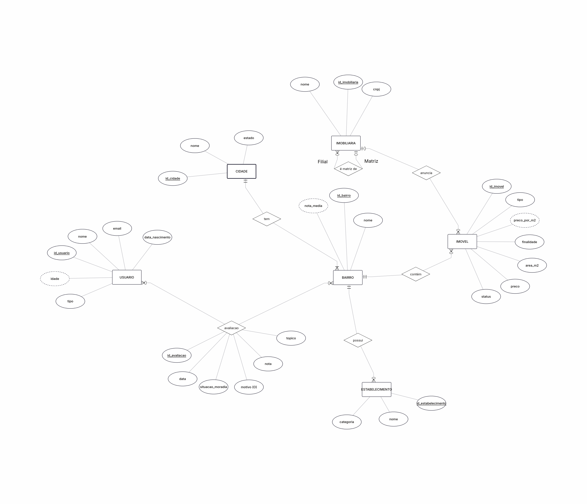
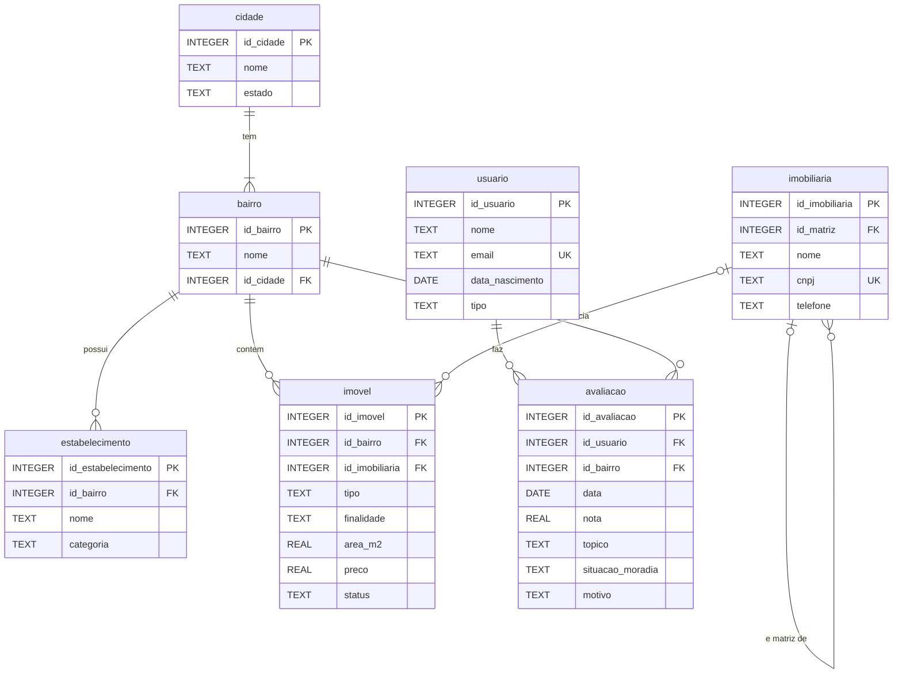
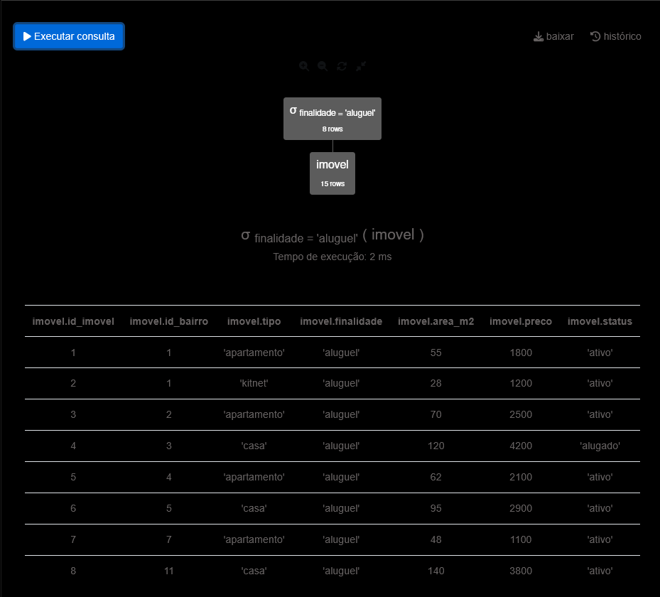
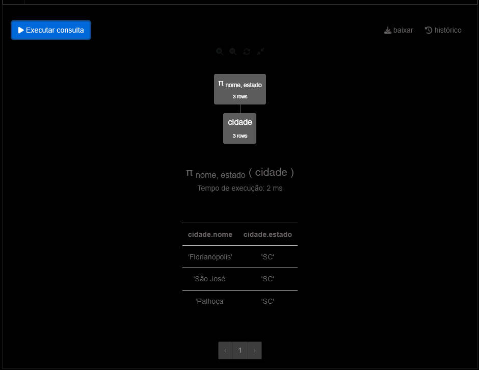
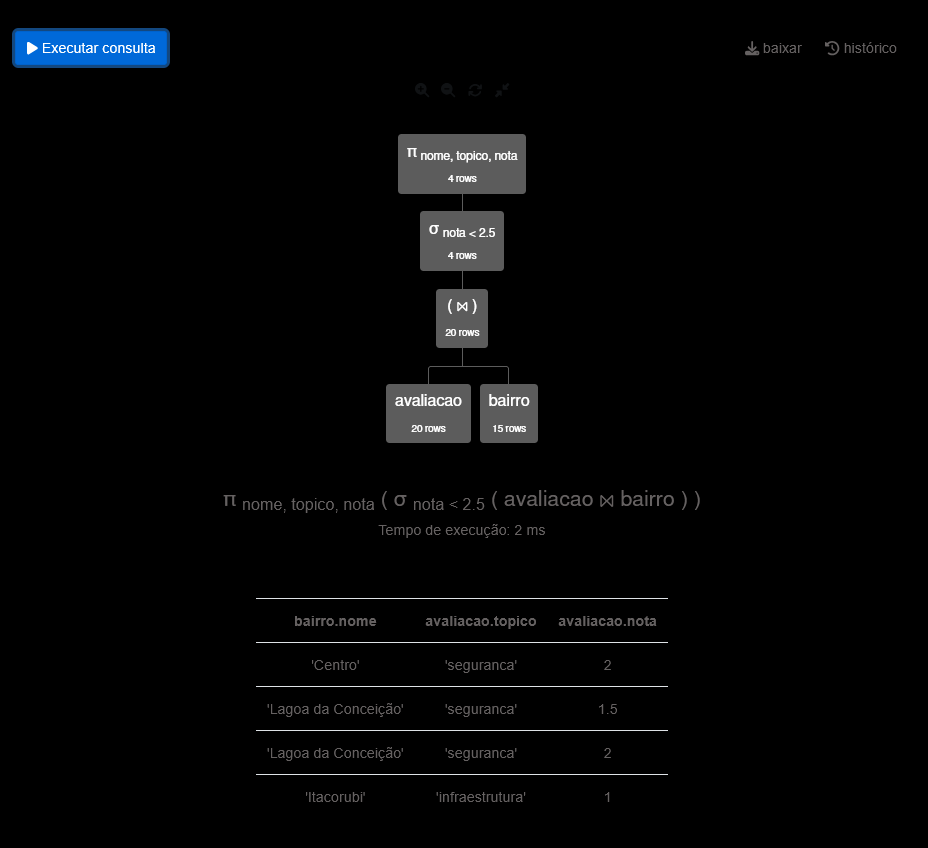

# Relatório do Projeto Final de Banco de Dados: Seu Vizin

Disciplina: Banco de Dados · Equipe: Matheus, Vitor, Nicolas e Raul · Entrega: 30/11/2026

## 1. Contexto

Quem procura um lugar para morar, principalmente quem vem de outra cidade, tem dificuldade para encontrar informação confiável sobre o bairro: segurança, infraestrutura, comércio, custo de vida e qualidade de vida. As informações costumam estar espalhadas e vêm, em geral, de quem quer vender ou alugar o imóvel.

O **Seu Vizin** é um aplicativo que resolve esse problema. Moradores atuais e antigos avaliam os bairros por tópico, o app mostra os serviços disponíveis em cada bairro (mercados, farmácias, escolas e transporte) e lista imóveis anunciados por imobiliárias, com preço, para que o interessado compare com a média da região.

Este relatório documenta o banco de dados relacional do app, construído com dados fictícios. As cidades e os bairros são reais (Grande Florianópolis), enquanto nomes de pessoas e empresas são inventados.

## 2. Regras de negócio

1.  O visitante pode pesquisar bairros sem login. Para avaliar é preciso ter conta.

2.  Todo usuário tem um tipo (morador, interessado, proprietário ou corretor) e o e-mail é único.

3.  Uma cidade tem vários bairros e cada bairro pertence a uma única cidade.

4.  Só moradores atuais ou antigos avaliam um bairro, e a avaliação informa a situação de moradia.

5.  Cada avaliação é de um tópico (segurança, infraestrutura, custo de vida, qualidade de vida ou comércio), com nota de 0,5 a 5,0.

6.  Um usuário avalia o mesmo tópico do mesmo bairro uma única vez.

7.  Nota abaixo de 2,5 exige um motivo em texto.

8.  A nota geral do bairro é a média das notas e só aparece com pelo menos 3 avaliações.

9.  Cada estabelecimento pertence a um bairro e tem uma categoria (mercado, farmácia, escola ou transporte).

10. O CNPJ de uma imobiliária não se repete, e uma imobiliária pode ser filial de outra (matriz).

11. Todo imóvel pertence a um bairro, pode ter imobiliária, tem finalidade (aluguel ou venda), preço maior que zero e nasce com status pendente.

12. O preço médio da região é calculado por bairro e por finalidade.

## 3. Modelo conceitual (MER)



O modelo tem 7 entidades, todas regulares. A **avaliação** é uma entidade associativa, porque nasce do relacionamento N:N entre usuário e bairro e carrega atributos próprios.

| Entidade                | Atributos                                                         | Observação              |
|-------------------------|-------------------------------------------------------------------|-------------------------|
| CIDADE                  | id_cidade, nome, estado                                           |                         |
| BAIRRO                  | id_bairro, nome, nota_media                                       | nota_media é derivado   |
| USUARIO                 | id_usuario, nome, email, data_nascimento, tipo, idade             | idade é derivado        |
| ESTABELECIMENTO         | id_estabelecimento, nome, categoria                               |                         |
| IMOBILIARIA             | id_imobiliaria, nome, cnpj                                        | tem autorrelacionamento |
| IMOVEL                  | id_imovel, tipo, finalidade, area_m2, preco, status, preco_por_m2 | preco_por_m2 é derivado |
| AVALIACAO (associativa) | id_avaliacao, topico, nota, motivo, situacao_moradia, data        | motivo é opcional       |

| Relacionamento                    | Entidades                 | Cardinalidade                                                                                 |
|-----------------------------------|---------------------------|-----------------------------------------------------------------------------------------------|
| tem                               | CIDADE e BAIRRO           | uma cidade tem de 1 a N bairros; um bairro é de exatamente uma cidade                         |
| possui                            | BAIRRO e ESTABELECIMENTO  | um bairro possui de 0 a N estabelecimentos; cada estabelecimento fica em exatamente um bairro |
| contém                            | BAIRRO e IMOVEL           | um bairro contém de 0 a N imóveis; cada imóvel fica em exatamente um bairro                   |
| anuncia                           | IMOBILIARIA e IMOVEL      | uma imobiliária anuncia de 0 a N imóveis; um imóvel tem no máximo uma imobiliária             |
| avalia (N:N)                      | USUARIO e BAIRRO          | um usuário avalia de 0 a N bairros; um bairro é avaliado por 0 a N usuários                   |
| é matriz de (autorrelacionamento) | IMOBILIARIA e IMOBILIARIA | uma matriz tem de 0 a N filiais; uma filial tem no máximo uma matriz                          |

**Atendimento aos requisitos do projeto:** mais de 6 entidades (7), relacionamento N:N (avalia), autorrelacionamento (é matriz de) e atributos derivados (idade, nota_media e preco_por_m2).

## 4. Modelo relacional

O modelo relacional foi montado a partir do MER. A regra de passagem foi: cada entidade vira uma tabela, e cada relacionamento 1:N vira uma chave estrangeira (FK) do lado "N". Dois casos mereceram tratamento especial:

- **Relacionamento N:N (usuário avalia bairro):** vira a tabela própria `avaliacao`, que guarda as FKs `id_usuario` e `id_bairro` mais os atributos do relacionamento (`topico`, `nota`, `motivo`, `situacao_moradia` e `data`).
- **Autorrelacionamento (imobiliária matriz e filial):** vira uma FK para a própria tabela, `imobiliaria.id_matriz`, que fica nula quando o registro é uma matriz.

Os atributos derivados (`idade`, `nota_media` e `preco_por_m2`) não viram colunas, pois são calculados nas consultas e views.



### Tabelas, chaves primárias e chaves estrangeiras

| Tabela | Chave primária | Chaves estrangeiras | Chaves únicas |
| --- | --- | --- | --- |
| cidade | id_cidade | (nenhuma) | |
| bairro | id_bairro | id_cidade → cidade | |
| usuario | id_usuario | (nenhuma) | email |
| avaliacao | id_avaliacao | id_usuario → usuario; id_bairro → bairro | (id_usuario, id_bairro, topico) |
| estabelecimento | id_estabelecimento | id_bairro → bairro | |
| imobiliaria | id_imobiliaria | id_matriz → imobiliaria (autorrelacionamento, aceita nulo) | cnpj |
| imovel | id_imovel | id_bairro → bairro; id_imobiliaria → imobiliaria (aceita nulo) | |

### Implementação (01_ddl.sql)

O banco é SQLite e o script começa com `PRAGMA foreign_keys = ON;`, que ativa a verificação das chaves estrangeiras (no SQLite ela vem desligada por padrão). As restrições do modelo foram implementadas assim:

| Restrição | Onde aparece |
| --- | --- |
| PRIMARY KEY | `id_...` de todas as tabelas |
| FOREIGN KEY | `bairro`, `avaliacao`, `estabelecimento`, `imobiliaria` e `imovel`, conforme a tabela acima |
| NOT NULL | Todos os campos obrigatórios; ficam opcionais só `id_matriz`, `id_imobiliaria`, `motivo` e `telefone` |
| UNIQUE | `usuario.email`, `imobiliaria.cnpj` e `avaliacao (id_usuario, id_bairro, topico)` (regra 6) |
| CHECK | `usuario.tipo`, `estabelecimento.categoria`, `imovel.tipo`, `imovel.finalidade`, `imovel.status`, `imovel.area_m2 > 0`, `imovel.preco > 0`, `imobiliaria.cnpj` com 14 caracteres, `avaliacao.nota` de 0,5 a 5,0, `avaliacao.topico`, `avaliacao.situacao_moradia` e nota abaixo de 2,5 exige motivo (regra 7) |
| DEFAULT | `imovel.status` nasce como `'pendente'` (regra 11) |

**ALTER TABLE documentado.** O telefone de contato da imobiliária não foi previsto na modelagem inicial, então foi adicionado depois com `ALTER TABLE imobiliaria ADD COLUMN telefone TEXT;`. A coluna é opcional (aceita nulo), o que mantém válidas as imobiliárias já cadastradas.

**Regra 4 (só morador avalia).** Ela não é imposta pelo banco: um CHECK não consegue consultar outra tabela (`usuario.tipo`), e isso exigiria um trigger. A regra fica a cargo da aplicação, e todas as avaliações do povoamento são de usuários do tipo morador.

## 5. Normalização até a 3FN

**1FN.** Todas as tabelas têm chave primária e só valores atômicos: nenhum campo guarda lista ou valor composto. Os atributos derivados (`idade`, `nota_media` e `preco_por_m2`) não são colunas, são calculados nas consultas e views.

**2FN.** Cada tabela tem chave primária de uma única coluna (`id_...`), então não existe dependência parcial: todo atributo depende da chave inteira.

**3FN.** Nenhuma tabela tem atributo não-chave que dependa de outro atributo não-chave (dependência transitiva). Dados de outra entidade ficam na própria tabela e entram por chave estrangeira.

### Por tabela

| Tabela | Chave | Dependências | Justificativa |
| --- | --- | --- | --- |
| cidade | id_cidade | id_cidade → nome, estado | Só descreve a cidade. O nome sozinho não determina o estado (existem cidades com o mesmo nome em estados diferentes), então não há dependência entre `nome` e `estado`. |
| bairro | id_bairro | id_bairro → nome, id_cidade | O bairro guarda só `id_cidade`. O nome e o estado da cidade ficam em `cidade`, o que evita repetir "Florianópolis" em cada bairro. |
| usuario | id_usuario | id_usuario → nome, email, data_nascimento, tipo | A idade não é guardada: depende de `data_nascimento` e mudaria com o tempo. O e-mail é chave candidata (UNIQUE), e todos os outros atributos dependem direto do usuário. |
| avaliacao | id_avaliacao | id_avaliacao → id_usuario, id_bairro, data, nota, topico, situacao_moradia, motivo | Guarda só as chaves estrangeiras `id_usuario` e `id_bairro`, sem nome de usuário nem de bairro. A nota média do bairro não é guardada, é calculada. (UNIQUE em id_usuario, id_bairro, topico garante a regra 6.) |
| estabelecimento | id_estabelecimento | id_estabelecimento → id_bairro, nome, categoria | Guarda só `id_bairro`; a cidade se obtém pelo bairro. |
| imobiliaria | id_imobiliaria | id_imobiliaria → id_matriz, nome, cnpj, telefone | A matriz é uma FK para a própria tabela, sem repetir os dados dela na filial. O CNPJ é chave candidata (UNIQUE). |
| imovel | id_imovel | id_imovel → id_bairro, id_imobiliaria, tipo, finalidade, area_m2, preco, status | Guarda só as FKs `id_bairro` e `id_imobiliaria`. O preço por m² não é guardado, é `preco / area_m2`. |

### Observação sobre `situacao_moradia`

A situação de moradia (atual ou antigo) fica em `avaliacao` e não em `usuario` porque ela é registrada **no momento da avaliação** e muda com o tempo: quem mora hoje em um bairro pode ter saído quando avaliar de novo. Por isso ela depende da avaliação inteira, e não só do par usuário-bairro. Os dados atuais não têm nenhum usuário com situações diferentes no mesmo bairro.

## 6. Dicionário de dados

Os tipos seguem o SQLite (`INTEGER`, `TEXT`, `REAL` e `DATE`). Os atributos derivados (idade, nota_media e preco_por_m2) não são colunas. Eles são calculados nas consultas e views: idade a partir de usuario.data_nascimento, nota_media como a média de avaliacao.nota por bairro e preco_por_m2 como preco dividido por area_m2.

### cidade

| Campo     | Tipo         | Restrições | Descrição               |
|-----------|--------------|------------|-------------------------|
| id_cidade | INTEGER | PK         | Identificador da cidade |
| nome      | TEXT | NOT NULL   | Nome da cidade          |
| estado    | TEXT | NOT NULL   | Estado da cidade        |

### bairro

| Campo     | Tipo         | Restrições            | Descrição                      |
|-----------|--------------|-----------------------|--------------------------------|
| id_bairro | INTEGER | PK                    | Identificador do bairro        |
| id_cidade | INTEGER | FK (cidade), NOT NULL | Cidade a que o bairro pertence |
| nome      | TEXT | NOT NULL              | Nome do bairro                 |

### usuario

| Campo           | Tipo         | Restrições                                                     | Descrição                       |
|-----------------|--------------|----------------------------------------------------------------|---------------------------------|
| id_usuario      | INTEGER | PK                                                             | Identificador do usuário        |
| nome            | TEXT | NOT NULL                                                       | Nome completo                   |
| email           | TEXT | NOT NULL, UNIQUE                                               | E-mail de acesso, sem repetição |
| data_nascimento | DATE | NOT NULL                                                       | Base para calcular a idade      |
| tipo            | TEXT | NOT NULL, CHECK (morador, interessado, proprietario, corretor) | Perfil do usuário               |

### avaliacao

| Campo            | Tipo         | Restrições                                                                              | Descrição                                                  |
|------------------|--------------|-----------------------------------------------------------------------------------------|------------------------------------------------------------|
| id_avaliacao     | INTEGER | PK                                                                                      | Identificador da avaliação                                 |
| id_usuario       | INTEGER | FK (usuario), NOT NULL                                                                  | Quem avaliou                                               |
| id_bairro        | INTEGER | FK (bairro), NOT NULL                                                                   | Bairro avaliado                                            |
| data             | DATE | NOT NULL                                                                                | Data da avaliação                                          |
| nota             | REAL | NOT NULL, CHECK (de 0,5 a 5,0)                                                          | Nota dada ao tópico                                        |
| topico           | TEXT | NOT NULL, CHECK (seguranca, infraestrutura, custo_de_vida, qualidade_de_vida, comercio) | Aspecto avaliado                                           |
| situacao_moradia | TEXT | NOT NULL, CHECK (atual, antigo)                                                         | Se o avaliador mora (atual) ou já morou (antigo) no bairro |
| motivo           | TEXT | Opcional; CHECK (obrigatório quando nota < 2,5)                                        | Justificativa da nota baixa                                |

Restrição da tabela: UNIQUE (id_usuario, id_bairro, topico). Cada usuário avalia o mesmo tópico do mesmo bairro uma única vez.

### estabelecimento

| Campo              | Tipo         | Restrições                                              | Descrição                        |
|--------------------|--------------|---------------------------------------------------------|----------------------------------|
| id_estabelecimento | INTEGER | PK                                                      | Identificador do estabelecimento |
| id_bairro          | INTEGER | FK (bairro), NOT NULL                                   | Bairro onde fica                 |
| nome               | TEXT | NOT NULL                                                | Nome do estabelecimento          |
| categoria          | TEXT | NOT NULL, CHECK (mercado, farmacia, escola, transporte) | Tipo de serviço                  |

### imobiliaria

| Campo          | Tipo         | Restrições                              | Descrição                                                       |
|----------------|--------------|-----------------------------------------|-----------------------------------------------------------------|
| id_imobiliaria | INTEGER | PK                                      | Identificador da imobiliária                                    |
| id_matriz      | INTEGER | FK (imobiliaria), aceita nulo           | Matriz da imobiliária; fica nulo quando o registro é uma matriz |
| nome           | TEXT | NOT NULL                                | Nome da imobiliária                                             |
| cnpj           | TEXT | NOT NULL, UNIQUE, CHECK (14 caracteres) | CNPJ somente com números                                        |
| telefone | TEXT | Opcional (aceita nulo); adicionado por ALTER TABLE | Telefone de contato da imobiliária |

### imovel

| Campo          | Tipo          | Restrições                                                              | Descrição                          |
|----------------|---------------|-------------------------------------------------------------------------|------------------------------------|
| id_imovel      | INTEGER | PK                                                                      | Identificador do imóvel            |
| id_bairro      | INTEGER | FK (bairro), NOT NULL                                                   | Bairro onde fica                   |
| id_imobiliaria | INTEGER | FK (imobiliaria), aceita nulo                                           | Imobiliária que anuncia, se houver |
| tipo           | TEXT | NOT NULL, CHECK (apartamento, casa, kitnet, terreno)                    | Tipo do imóvel                     |
| finalidade     | TEXT | NOT NULL, CHECK (aluguel, venda)                                        | Para que está anunciado            |
| area_m2        | REAL | NOT NULL, CHECK (> 0)                                                  | Área em metros quadrados           |
| preco          | REAL | NOT NULL, CHECK (> 0)                                                  | Valor do aluguel ou da venda       |
| status         | TEXT | NOT NULL, DEFAULT 'pendente', CHECK (pendente, ativo, alugado, vendido) | Situação do anúncio                |

## 7. Álgebra relacional

As expressões foram testadas no RelaX com os dados do povoamento.

**A1. Seleção.** Quais imóveis estão anunciados para aluguel?

`σ finalidade = 'aluguel' (imovel)`

Selecionamos só as linhas de imovel em que a finalidade é aluguel. O resultado tem 8 imóveis.



**A2. Projeção.** Quais são os nomes e os estados das cidades cadastradas?

`π nome, estado (cidade)`

Mantemos só as colunas nome e estado da tabela cidade. O resultado tem 3 cidades.



**A3. Junção, seleção e projeção.** Quais bairros receberam avaliações com nota baixa, e em qual tópico?

`π nome, topico, nota (σ nota < 2.5 (avaliacao ⨝ bairro))`

Juntamos avaliacao com bairro pela coluna em comum (id_bairro), filtramos as notas abaixo de 2,5 e mostramos nome do bairro, tópico e nota. O resultado tem 4 linhas: Centro, Lagoa da Conceição (duas) e Itacorubi.



## 8. Consultas SQL

### 8.1 Consultas de junção (Q8 a Q12)

Autor: Vitor. As consultas estão em `sql/03_consultas.sql`.

**Q8.** Quem avaliou o quê? Lista cada avaliação com o morador, o bairro, o tópico, a nota e a data.

- **Técnica:** INNER JOIN entre 3 tabelas (`usuario`, `avaliacao`, `bairro`).
- **Resultado:** 20 linhas, uma por avaliação cadastrada.

```sql
SELECT u.nome AS usuario,
       b.nome AS bairro,
       a.topico,
       a.nota,
       a.data
FROM avaliacao a
INNER JOIN usuario u ON u.id_usuario = a.id_usuario
INNER JOIN bairro  b ON b.id_bairro  = a.id_bairro
ORDER BY b.nome, a.data;
```

**Q9.** Quais bairros ainda não receberam nenhuma avaliação (e por isso não têm nota para exibir)?

- **Técnica:** LEFT JOIN de `bairro` com `avaliacao`: os bairros sem correspondência aparecem com `NULL` e o `WHERE ... IS NULL` deixa só eles.
- **Resultado:** 6 bairros: Aririú, Pagani, Passa Vinte, Pedra Branca, Ponte do Imaruim e Forquilhinhas.

```sql
SELECT b.nome AS bairro,
       c.nome AS cidade
FROM bairro b
INNER JOIN cidade c ON c.id_cidade = b.id_cidade
LEFT JOIN avaliacao a ON a.id_bairro = b.id_bairro
WHERE a.id_avaliacao IS NULL
ORDER BY c.nome, b.nome;
```

**Q10.** Como fica a lista de imóveis anunciados, com bairro, cidade e imobiliária responsável?

- **Técnica:** JOIN entre 4 tabelas (`imovel`, `bairro`, `cidade`, `imobiliaria`). A imobiliária é opcional (regra 11), então é um LEFT JOIN; com INNER JOIN os imóveis sem imobiliária sumiriam. `COALESCE` mostra "Sem imobiliaria" nesses casos.
- **Resultado:** 15 linhas, incluindo os imóveis 6 e 14, que não têm imobiliária.

```sql
SELECT i.id_imovel,
       i.tipo,
       i.finalidade,
       i.preco,
       b.nome AS bairro,
       c.nome AS cidade,
       COALESCE(im.nome, 'Sem imobiliaria') AS imobiliaria
FROM imovel i
INNER JOIN bairro b ON b.id_bairro = i.id_bairro
INNER JOIN cidade c ON c.id_cidade = b.id_cidade
LEFT JOIN imobiliaria im ON im.id_imobiliaria = i.id_imobiliaria
ORDER BY c.nome, b.nome, i.id_imovel;
```

**Q11.** Quantos imóveis cada imobiliária anuncia, incluindo as que não têm nenhum?

- **Técnica:** LEFT JOIN com `COUNT` e `GROUP BY`. O `COUNT(i.id_imovel)` conta só as linhas com imóvel; `COUNT(*)` contaria 1 para a imobiliária sem imóveis.
- **Resultado:** 6 imobiliárias; a Morar Bem Imóveis aparece com 0 imóveis.

```sql
SELECT im.id_imobiliaria,
       im.nome AS imobiliaria,
       COUNT(i.id_imovel) AS qtd_imoveis
FROM imobiliaria im
LEFT JOIN imovel i ON i.id_imobiliaria = im.id_imobiliaria
GROUP BY im.id_imobiliaria, im.nome
ORDER BY qtd_imoveis DESC, im.nome;
```

**Q12.** Quantos estabelecimentos cada bairro tem, com a cidade a que pertence?

- **Técnica:** INNER JOIN entre 3 tabelas (`estabelecimento`, `bairro`, `cidade`) com `GROUP BY`. Só aparecem bairros com ao menos um estabelecimento.
- **Resultado:** 9 bairros; Centro, Trindade e Kobrasol lideram com 3 estabelecimentos cada.

```sql
SELECT c.nome AS cidade,
       b.nome AS bairro,
       COUNT(e.id_estabelecimento) AS qtd_estabelecimentos
FROM estabelecimento e
INNER JOIN bairro b ON b.id_bairro = e.id_bairro
INNER JOIN cidade c ON c.id_cidade = b.id_cidade
GROUP BY c.id_cidade, c.nome, b.id_bairro, b.nome
ORDER BY c.nome, qtd_estabelecimentos DESC, b.nome;
```

(Demais consultas (Q1 a Q7 e Q13 a Q17), views e índice: a preencher quando o 03_consultas.sql estiver pronto.)

## 9. Participação da equipe

| Integrante | Responsabilidades                                          |
|------------|------------------------------------------------------------|
| Matheus    | MER, álgebra relacional, dicionário de dados e relatório   |
| Vitor      | Modelo relacional, normalização, DDL e consultas de junção |
| Nicolas    | Povoamento (DML), consultas de filtro e agregação          |
| Raul       | Subconsultas, UNION/CASE, views e índice                   |
